# Domain-Driven Design (DDD) Architecture Specification

Dokumen ini menjelaskan arsitektur perangkat lunak **Buzzer Media Backend** yang dirancang dengan prinsip **Domain-Driven Design (DDD)** dan **Hexagonal Architecture (Ports and Adapters)**.

---

## 1. Diagram Layer Arsitektur

```mermaid
graph TD
    subgraph Infrastructure_Adapters [Adapters & Infrastructure]
        VPS[Axum / Tokio VPS Adapter]
        CF[Cloudflare Worker WASM Adapter]
        DB[(D1 / SQLite / In-Memory Repositories)]
        SMM[SMM Provider HTTP Gateway]
        Storage[R2 / Local Disk File Storage]
    end

    subgraph Application_Layer [Application Layer - Use Cases & Ports]
        PlaceOrder[PlaceOrderUseCase]
        MassOrder[MassOrderUseCase]
        RequestDeposit[RequestDepositUseCase]
        ApproveDeposit[ApproveDepositUseCase]
        SyncOrder[SyncOrderUseCase]
        ClaimRefill[ClaimRefillUseCase]
        UserRepoPort[UserRepository Port]
        OrderRepoPort[OrderRepository Port]
        DepositRepoPort[DepositRepository Port]
        ProviderPort[SmmProviderGateway Port]
    end

    subgraph Domain_Layer [Pure Domain Layer]
        UserEntity[User Entity & Balance Ledger]
        OrderEntity[Order Entity & Status Engine]
        ServiceEntity[Service Entity & Pricing Rules]
        DepositEntity[Deposit Entity & Unique Code]
        MoneyVO[Money Value Object]
        DomainErrors[Domain Errors]
        DomainEvents[Domain Events]
    end

    VPS --> PlaceOrder
    CF --> PlaceOrder
    PlaceOrder --> UserEntity
    PlaceOrder --> OrderEntity
    PlaceOrder --> UserRepoPort
    PlaceOrder --> OrderRepoPort
    UserRepoPort -.-> DB
    OrderRepoPort -.-> DB
    ProviderPort -.-> SMM
```

---

## 2. Lapisan Domain (Pure Domain Layer)

Lapisan domain tidak memiliki ketergantungan pada pustaka eksternal, framework web (Axum/Wrangler), atau basis data. Lapisan ini hanya berisi aturan bisnis murni:

### Value Objects
* **`Money`**: Objek nilai mata uang Rupiah (`amount: i64`) untuk mencegah kesalahan komputasi desimal (*floating point inaccuracies*).
  * Menghitung harga pesanan: $\text{Harga} = \lceil (\text{Jumlah} / 1.000) \times \text{HargaPerK} \rceil$.
  * Menghitung pengembalian dana parsial: $\text{Refund} = \lfloor (\text{Remains} / \text{Jumlah}) \times \text{HargaTotal} \rfloor$.
* **Typed IDs**: `UserId`, `OrderId`, `ServiceId`, `DepositId`, `TicketId` untuk mencegah *primitive obsession*.
* **`OrderStatus`**: State machine pesanan (`Pending` $\rightarrow$ `Processing` $\rightarrow$ `Success` / `Partial` / `Canceled` / `Error`).
* **`DepositStatus`**: State machine top-up (`Pending` $\rightarrow$ `WaitingVerification` $\rightarrow$ `Success` / `Rejected` / `Expired`).

### Entities & Aggregates
* **`User`**: Memvalidasi kecukupan saldo sebelum debit, mencatat mutasi ke `BalanceLog`.
* **`Order`**: Mengontrol transisi status pesanan dan kalkulasi refund parsial.
* **`Service`**: Memvalidasi batas minimal dan maksimal jumlah pesanan.
* **`Deposit`**: Mengelola perhitungan kode unik 3-digit dan verifikasi unggahan struk QRIS.

---

## 3. Lapisan Aplikasi (Application Layer - Use Cases & Ports)

Mengatur alur proses bisnis tanpa terikat pada teknologi HTTP atau runtime:

* **Inbound Use Cases**:
  * `PlaceOrderUseCase`: Memeriksa ketersediaan layanan, memotong saldo pengguna, membuat entitas pesanan, dan meneruskan ke provider gateway.
  * `MassOrderUseCase`: Mem-parsing baris per baris (`ID|Target|Jumlah`), memvalidasi baris, dan mengeksekusi secara batch.
  * `RequestDepositUseCase`: Menghasilkan tiket deposit baru dengan kode unik 3-digit acak.
  * `ApproveDepositUseCase`: Memverifikasi struk manual QRIS, mengkredit saldo pengguna secara instan, dan mencatat log mutasi.
  * `SyncOrderUseCase`: Menyelaraskan status dari server provider dan mengembalikan saldo sisa jika berstatus `Partial` atau `Canceled`.

* **Outbound Ports (Traits)**:
  * `UserRepository`, `OrderRepository`, `ServiceRepository`, `DepositRepository`, `TicketRepository`.
  * `SmmProviderGateway`, `FileStorageGateway`.

---

## 4. Lapisan Adaptor (Adapters Layer)

Memungkinkan perpindahan (*agnostic switching*) antara Cloudflare Workers dan VPS:

* **VPS Runtime (`src/bin/server.rs`)**:
  * Menggunakan framework Axum dan runtime Tokio.
  * Berjalan pada port 8080 di VPS / kontainer Docker standar.
* **Cloudflare Workers Runtime (`infra/cloudflare/worker.js`)**:
  * Menggunakan binding database D1, KV, dan R2 bucket.
* **In-Memory Repositories (`src/adapters/in_memory/`)**:
  * Implementasi thread-safe `Arc<RwLock<HashMap<...>>>` untuk pengujian TDD instan tanpa perlu menjalankan database eksternal.
