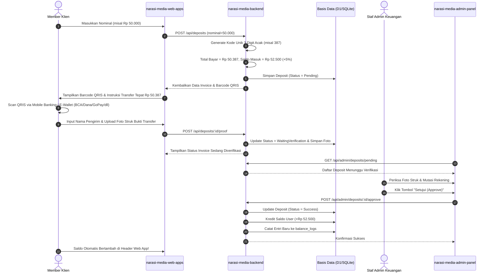

# Alur Kerja Deposit QRIS Manual & Verifikasi Admin

Dokumen ini menguraikan secara rinci siklus hidup fitur **Deposit QRIS Manual** pada platform Narasi Media, yang dirancang tanpa ketergantungan pada pihak ketiga pada tahap awal peluncuran.

---

## 1. Diagram Alur Proses (Sequence Diagram)

---

## 2. Keunggulan Mekanisme Kode Unik 3-Digit
1. **Pembeda Transaksi Identik**: Jika 10 pengguna mentransfer `Rp 50.000` di waktu bersamaan, sistem memberikan kode unik berbeda (misal `Rp 50.123`, `Rp 50.456`, `Rp 50.789`).
2. **Mempermudah Verifikasi Admin**: Admin hanya perlu mencocokkan nominal 3 digit terakhir pada notifikasi mutasi rekening m-banking.
3. **Pemberian Promo Bonus**: Seluruh kode unik tetap menjadi hak pengguna atau ditambahkan bonus promo saldo (misal +5%), memberikan insentif positif bagi pengguna.
